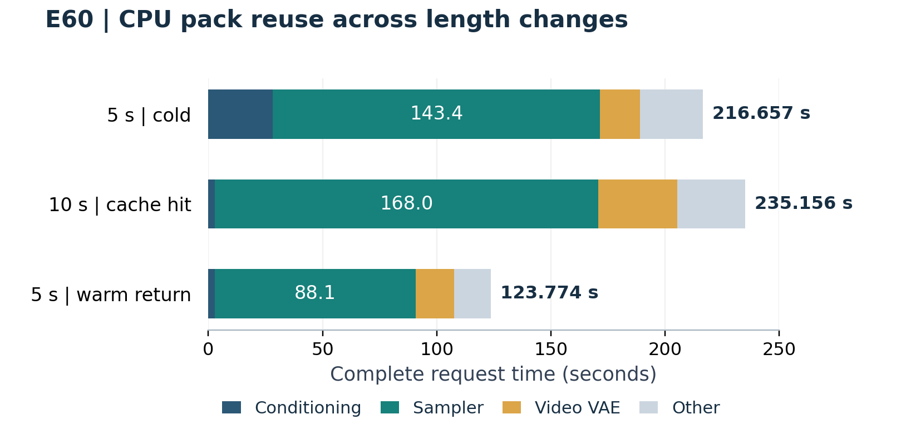

# MiniMax H3 for Dual RTX 2080 Ti + NVLink

[简体中文](README.zh-CN.md) · [Install](docs/INSTALL.md) · [Models](docs/MODELS.md) · [Settings](docs/SETTINGS.md) · [Experiments](docs/RESULTS.md)

For an installation agent: follow [the step-by-step setup and success checks](docs/AGENT_SETUP.md) and [AGENTS.md](AGENTS.md).

**An RTX 2080 Ti / SM75 acceleration project for ComfyUI, measured on two 22 GB cards connected by NVLink.**

| Historical same-input TP comparison | Before: one GPU | After: two GPUs with TP | Speedup |
|---|---:|---:|---:|
| Qwen warm streaming encode, including preparation/release · E36 | 5.305 s | 2.570 s | **2.064×** |
| Attention routing + quantization + kernel, same Kitchen backend · E21 | 60.307 ms | 30.981 ms | **1.947×** |
| Complete video VAE decode, FP32 on both paths · E29 | 105.816 s | 57.684 s | **1.834×** |
| Early full transformer block, INT8/Kitchen50, chunk2048 · E22 | 238.039 ms | 176.618 ms | **1.348×** |

These measure **TP at the stated scopes**, not a single-GPU versus dual-GPU complete-video speedup. E36 uses warm CPU packs on both paths. E21 uses CUDA-event time, taking the slower TP rank. E22 uses the project's same-operator single-GPU implementation, with weights already resident; it predates the current chunk4096/tuned-FC2/joint/offset default and is not a fresh measurement of it. E29 excludes model loading and reports the second decode. Qwen/VAE outputs are not identical. [Configuration audit, inputs, timing boundaries and numerical differences](docs/TP-COMPARISON.md).

With the broader optimized pipeline, the fastest recorded successful **5-second 864×480 video took 110.617 seconds** (E52, warm, distilled 8-step configuration). That is a complete-request result with additional optimizations and precision choices, not the TP-only comparison above.

### What tensor parallelism does

TP splits large layer weights into two shards. **Both RTX 2080 Ti cards compute different parts of the same layer at the same time**, then exchange the required activations or partial results. This uses both cards' compute resources for one generation. Grouped streaming and CPU caches stage the weight shards within the available VRAM.

**NVLink provides the high-bandwidth GPU-to-GPU connection needed to make these frequent exchanges practical on this setup.** The implementation uses direct peer copies and CUDA events; it avoids routing those transfers through CPU memory. The measured platform has an `NV2` link. A link-disabled comparison was not measured, and other interconnects are unvalidated. This repository targets **dual RTX 2080 Ti 22 GB / SM75**, not generic multi-GPU hardware or stock 11 GB cards.

This experimental custom-node pack builds on [Comfy-H3-MultiStream](https://github.com/martonsagi/Comfy-H3-MultiStream). Its development target is a Supermicro X9DAi with **2 × Xeon E5-2620 v2, 256 GB DDR3, and 2 × RTX 2080 Ti 22 GB connected by NVLink**. It does not require a GPU unlock or a modified ComfyUI core.

**Speed-first by default:** the launcher selects `configs/performance.json` when `--config` is omitted. Pair it with the bundled performance workflows after installing the required operators. This enables tuned FC2, joint SwiGLU, shared-KV/offset routing and local FP16 VAE FFN accumulation. RAM preload stays opt-in. Failed internal-FP16-output and FP16-LoRA candidates are excluded.

## What this project adds

- **TP2 for the H3 transformer:** INT8 ConvRot linear layers, direct event-driven GPU-to-GPU exchange, chunked activation communication, and grouped double-buffered weight streaming.
- **Reuse instead of repacking:** immutable canonical CPU packs survive changes in token count; `auto_tokens` chooses bounded GPU groups/slots. This helps repeated jobs with different video lengths.
- **Faster conditioning:** Qwen H3 GGUF CPU streaming/TP2, plus a separate reference-encoder DP node for eligible multi-reference inputs.
- **VAE optimization:** selectable FP32/mixed/FP16 TP2 policies, optional SwiGLU fusion, optional local FP16 FFN accumulation, and decoder prefetch during the final eligible Euler step.
- **SM75 kernels:** tuned INT8 FC2 GEMM, joint main/LoRA SwiGLU, shared-KV/offset Sparse Kitchen paths, with source, build scripts and a [checksum-pinned Linux prebuilt release](docs/PREBUILT.md).
- **An optional RAM-resident loader:** keep a selected weight set in locked host RAM. This is a separate launch option, not a requirement for using the nodes.

The TP2 path is distinct from the inherited general MultiStream path. This fork's published performance results cover **two SM75 GPUs with direct peer access**, not arbitrary multi-GPU hardware.

## A few measured results

All rows use 864 × 480, 24 fps, Larry v4 step600 EMA, 8 Euler/simple steps and INT8 ConvRot H3. These are different runs/configurations, **not one cumulative speedup comparison**.

| Experiment | Output | Cache / task | Complete request time | Effective output fps |
|---|---|---|---:|---:|
| E52 | 5 s / 120 frames | FL2VA, warm combined configuration | **110.617 s** | **1.085** |
| E60 | 5 s / 120 frames | FL2VA text-only, RAM-preloaded, warm return after a length change | **123.774 s** | **0.970** |
| E60 | 10 s / 240 frames | FL2VA text-only, RAM-preloaded, canonical CPU cache hit | **235.156 s** | **1.021** |
| E57 | 15 s / 360 frames | FL2VA first/last-frame conditioning, first request after RAM preload | **501.450 s** | **0.718** |
| E75 | 5 s / 120 frames | Ref2VA, two references, RAM-preloaded, cold request, stock GPUs | **223.048 s** | **0.538** |

Request time is ComfyUI `execution_start → execution_success`, including conditioning, sampling, VAE and video saving, excluding queueing/server startup/weight preload. Most rows are single observations. The matched E52 comparison was **115.734 → 110.617 s (1.046×)**; precision-changing options were part of that combination. See [results and limitations](docs/RESULTS.md).

Effective fps is saved frames divided by complete request time, not playback fps or sampling-only throughput. For speed-oriented use, **E60 provides the strongest short-sequence evidence: 5 s cold → 10 s → 5 s all succeeded**, with cache reuse across length changes. E52 is the fastest recorded successful warm 5-second run here; E57/E75 are successful individual requests. None establishes long unattended queue stability. [Which profile to use, exact settings and stability evidence](docs/SPEED.md).



### Example outputs

Click a preview to open its audio/video file. Media container metadata has been removed; private input reference assets and model weights are not included.

| 5-second output · E52 · 110.617 s | 10-second output · E60 · 235.156 s | 15-second output · E57 · 501.450 s |
|---|---|---|
| [](examples/videos/e52-480p-5s.mp4) | [](examples/videos/e60-480p-10s.mp4) | [](examples/videos/e57-480p-15s.mp4) |

## Install and connect

Install this repository into `ComfyUI/custom_nodes/ComfyUI-H3-2080Ti-TP`. **Remove/disable the original MultiStream copy first**: both packs register the same node identifiers.

```bash
cd ComfyUI/custom_nodes
git clone https://github.com/Luna-AI-Infra/ComfyUI-H3-2080Ti-TP.git
git clone https://github.com/city96/ComfyUI-GGUF.git
git -C ComfyUI-GGUF checkout 373048b8403a7820620065210a691263d4da0a61
python -m pip install -r ComfyUI-GGUF/requirements.txt
cd ComfyUI-H3-2080Ti-TP
# Use the Python environment that runs ComfyUI.
python scripts/bootstrap_backends.py
python scripts/install_prebuilt.py
python scripts/doctor.py --comfyui ../..
```

These commands assume an existing working **Linux ComfyUI environment**, with its dependencies installed and two P2P-capable CUDA GPUs. They are not a fresh OS installer. The pinned Sparse Kitchen source includes a prebuilt Linux library; a toolkit/compiler is needed when rebuilding it or enabling this pack's additional native kernels. If GGUF is already installed, inspect its version instead of cloning over it. Use the same Python for every command. `doctor.py` reports capabilities; a zero exit status does not certify readiness.

Place the exact model variants from [the model manifest and download links](docs/MODELS.md) into ComfyUI's model folders. Staying in this plugin directory:

```bash
# Text-only / first-last-frame example; use --task ref2va for reference tasks.
python scripts/verify_models.py --comfyui ../.. --task fl2va
python scripts/launch_comfyui.py --comfyui ../.. -- --port 8189
# In another terminal, with the same Python and plugin working directory:
python scripts/run_workflow.py --url http://127.0.0.1:8189 --workflow workflows/api/t2va-480p-5s.json
```

The verifier fails if any required asset is missing or mismatched; it reads about 55 GiB. The workflow check does not submit a video. The default performance preset requires the six libraries installed above; [download checksums, CUDA12 runtime requirements and source-build alternative](docs/PREBUILT.md) are documented. `--config configs/conservative.json` is an explicit diagnostic fallback, not the recommended speed profile; graph-side fusion/backend settings must also be adjusted. See [the complete installation guide](docs/INSTALL.md). Node registration alone does not validate backend library loading or GPU execution.

Typical graph:

```text
H3 loader → runtime Larry LoRA → H3 Tensor Parallel → H3 Load Pipeline → native sampler
Qwen GGUF loader → H3 Qwen Execution → native H3 conditioning / H3 Reference to Video DP
native sampler → H3 TP VAE Decode → native audio/video save nodes
```

Use [UI examples](workflows/ui/) in the editor and [API examples](workflows/api/) for HTTP submissions. Their format and validation status are documented in [workflows/README.md](workflows/README.md). A workflow alone does not carry process environment settings.

For reference-image generation, use the [Ref2VA editor workflow and walkthrough](workflows/REF2VA.md), with two bundled [CC0 robot reference images](examples/reference/). It defaults to `match` reference sizing and includes a matching API graph. Import/export and native graph validation passed; this new input pair has no measured generation time yet.

The tested host is **ComfyUI 0.42.0**, runtime-equivalent to upstream [`46aad33e4d4c0696582611bf450dd93742fa9090`](https://github.com/Comfy-Org/ComfyUI/commit/46aad33e4d4c0696582611bf450dd93742fa9090). The recorded deployment HEAD only adds documentation. For agents: identify the existing Python environment → check duplicate node packs → build selected backends/kernels → verify required model hashes → start an isolated server → check a graph with `scripts/run_workflow.py` → submit one requested test with `--submit`.

### Tested model downloads

| Component | Exact tested variant | Download |
|---|---|---|
| FL2VA main model | Full, unpruned INT8 ConvRot | [Checkpoint](https://huggingface.co/Comfy-Org/MiniMax-H3/blob/main/diffusion_models/minimax_h3_fl2va_int8_convrot.safetensors) |
| Ref2VA main model | Full, unpruned INT8 ConvRot; choose for reference tasks | [Checkpoint](https://huggingface.co/Comfy-Org/MiniMax-H3/blob/main/diffusion_models/minimax_h3_ref2va_int8_convrot.safetensors) |
| H3 Qwen3-VL-32B | H3-specific GGUF **Q4_K_M**, not a generic chat model | [Checkpoint](https://huggingface.co/leejet/MiniMax-H3-GGUF/blob/main/qwen3vl_32b_minimax_h3-Q4_K_M.gguf) |
| Video VAE | FP16 checkpoint | [Checkpoint](https://huggingface.co/Comfy-Org/MiniMax-H3/blob/main/vae/minimax_h3_video_vae_fp16.safetensors) |
| Audio VAE | FP32 checkpoint | [Checkpoint](https://huggingface.co/Comfy-Org/MiniMax-H3/blob/main/vae/minimax_h3_audio_vae_fp32.safetensors) |
| Larry Turbo LoRA | **v4 step600 EMA**, runtime FP32 increment | [Checkpoint](https://huggingface.co/larryvrh/MiniMax-H3-Turbo-Lora/blob/main/minimax_h3_turbo_v4_step600_ema.safetensors) |

FL2VA and Ref2VA are alternatives for different tasks. Storage dtype/quantization is distinct from compute/accumulation precision. [Pinned URLs, placement and SHA256](configs/models.json) are provided for reproducibility; weights are not bundled.

## Defaults and quality tradeoffs

**The recommended default is the performance launcher plus the bundled workflows.** Source fallbacks for manually created nodes or direct `main.py` startup are different: Sage attention, chunk 2048, three groups/two slots, FP32 VAE FFN accumulation, and joint SwiGLU enabled. They do not automatically reproduce the advertised speed profile. The conservative preset is an explicit troubleshooting option, not an all-FP32 quality reference.

The performance preset selects Kitchen 50%, chunk 4096, canonical packed caching in the paired API graph, tuned FC2, joint fusion, offset routing, and local FP16 VAE FFN accumulation. Main transformer internal output remains `original`, runtime LoRA remains FP32. See [the full defaults/overrides table](docs/SETTINGS.md).

Sparse attention, quantization, FP16 VAE computation, local FP16 accumulation and distilled 8-step sampling can change outputs. Local parity checks are not an end-to-end losslessness claim. The `linears_fp16` internal-output experiment produced non-finite values and is not a recommended preset.

## Validated environment

| Component | Measured setup |
|---|---|
| Mainboard / CPU | Supermicro X9DAi; 2 × Xeon E5-2620 v2 @ 2.10 GHz; 12 cores / 24 threads total |
| RAM | 4 × 64 GB DDR3, 256 GB installed; 1066 MT/s configured; two NUMA nodes |
| GPU / interconnect | 2 × RTX 2080 Ti with 22 GB VRAM each; NVLink (`NV2` topology) |
| OS / kernel | Ubuntu 22.04.5 LTS; Linux 5.15.0-191-generic |
| NVIDIA driver | 595.91.07; no unlock required |
| Python / PyTorch | 3.11.16 / 2.11.0+cu130; PyTorch CUDA runtime 13.0 |
| Native kernel compiler | CUDA toolkit 12.8; CUTLASS 3.8.0 for tuned FC2 |
| ComfyUI | 0.42.0; tested commit `8b219284fd56145c21fa7522c9ebb85125b80d08` |
| Additional packages | comfy-kitchen 0.2.39; comfy-aimdo 0.5.6; gguf 0.19.0; frontend 1.57.1 |

These are tested versions, not a guarantee for every newer release. [Exact dependency commits](docs/INSTALL.md) and [checkpoint hashes](configs/models.json) are included.

## Queue support and current limits

Use the standard ComfyUI queue: multiple clients can submit jobs, and a single worker executes them serially. One TP2 render uses both GPUs. This is not concurrent two-video serving or multi-process GPU isolation.

Three concurrently submitted lightweight control jobs passed queue testing. E60 completed a sequence of different-length renders, but other repeated H3 runs have produced CUDA illegal instructions/Xid errors. A recent stock-state cold Ref2VA request passed; sustained heavy-job stability and fatal-CUDA-error recovery remain unresolved. Stop processing after a fatal GPU error; do not assume the next queued render is safe. See [known issues](docs/KNOWN_ISSUES.md).

## Experiment paper and provenance

- [English experiment paper (PDF)](docs/paper/H3-TP-Experiments.en.pdf)
- [中文实验论文（PDF）](docs/paper/H3-TP-Experiments.zh-CN.pdf)
- [Detailed results](docs/RESULTS.md) and [selected sanitized original reports](docs/experiments/)
- [Upstream attribution](docs/ATTRIBUTION.md), [LICENSE](LICENSE), [NOTICE](NOTICE)

This repository preserves upstream attribution but starts a new public Git history so private developer paths and author-email history are not published. Selected reports are redacted exports, not byte-identical raw logs. Models are distributed by their respective authors under their own terms and are not bundled here.
