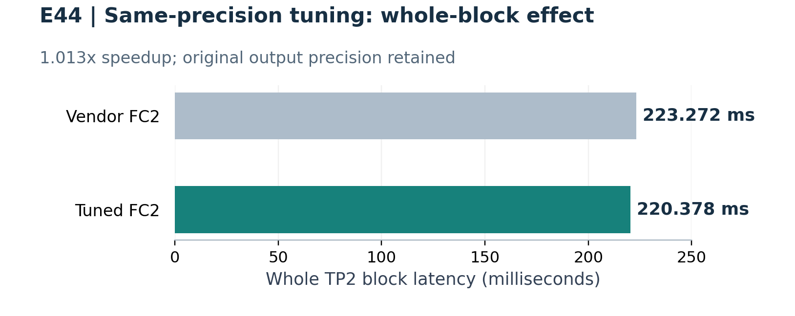
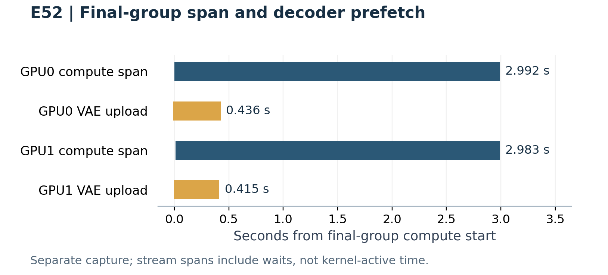

# 双 Turing GPU 上的 MiniMax H3 推理优化

## 张量并行、主机权重缓存复用与显式精度取舍

Luna-AI-Infra | 工程实验报告 | 2026年10月25日

## 摘要

本文记录在两张22GB RTX2080Ti上运行MiniMax H3的ComfyUI工程优化。实现组合了TP2、事件驱动P2P、分组权重流式搬运、canonical CPU打包缓存、Qwen流式编码、VAE预载及可选SM75内核。一次配对组合实验将5秒视频的完整请求耗时从115.734秒降至110.617秒；另一组切换长度的连续任务中，主干准备从62.234秒降至约0.5秒，并避免重复打包。实验包含480p的5秒、10秒和15秒完整输出。这些结果不能累乘为统一加速比，也不能证明画质不变。部分低精度选项有局部误差，部分更快候选因失败撤回，重复重任务中的CUDA错误尚未定位。

## 1. 研究范围与主要工作

目标是在双路DDR3旧平台和有限单卡显存条件下完成实际视频生成。本文的贡献是可集成的工程实现、测量记录和精度取舍分析，不是新视频模型，也不主张达到通用最先进推理速度。

- 专用双卡H3运行时：整数线性层、分块P2P通信、有边界的分组权重驻留。
- canonical不可变主机权重母版：不同token数量使用不同GPU分组时复用CPU布局，避免换长度后重打包。
- Qwen编码器、参考编码器和视频VAE分别优化，通过ComfyUI节点及显式进程开关组合。
- 提供带来源说明的CUDA源码、可移植构建和启动入口，并保留成功、撤回和失败证据。

实现基于Comfy-H3-MultiStream，新增TP2路径与继承的通用MultiStream路径不同。本文测量域是有直接P2P的双SM75显卡，不覆盖任意卡数、新架构或多进程并发生成。

本文为工程报告，未经同行评审。完整生成结果多数是单台机器上的单次观测。公开包使用新的源码历史；历史速度不能自动视为每一项公开打包改动都已通过新的端到端性能验证。

<!-- pagebreak -->

## 2. 实验平台、模型与测量口径

| 项目 | 核实配置 |
|---|---|
| 主机 | Supermicro X9DAi；双Xeon E5-2620 v2，2.10GHz；共12核24线程 |
| 内存 | DDR3 64GB×4，共256GB；配置1066MT/s；双NUMA节点 |
| 显卡 | RTX2080Ti 22GB×2；NVLink，拓扑NV2 |
| 系统 | Ubuntu22.04.5 LTS；Linux5.15.0-191-generic；NVIDIA595.91.07 |
| 运行时 | Python3.11.16；PyTorch2.11.0+cu130；PyTorch CUDA运行时13.0 |
| 内核编译 | CUDA Toolkit12.8；调优INT8 FC2使用CUTLASS3.8.0 |
| ComfyUI | 0.42.0；运行时代码基线46aad33e4d4c0696582611bf450dd93742fa9090 |
| 依赖 | comfy-kitchen0.2.39；comfy-aimdo0.5.6；gguf0.19.0；前端1.57.1 |

记录中的应用HEAD8b21928只在运行时基线上增加部署文档；最终H3运行时记录为4369debd。本公开包不要求功能性的ComfyUI核心补丁，也不要求显卡算力解锁。早期实验采用不同H3实现提交，原报告分别记录。

| 模型组件 | 实际采用版本 |
|---|---|
| 主干 | 完整、未剪枝的FL2VA或Ref2VA INT8 ConvRot；保留原AdaLN结构 |
| 条件编码器 | H3专用Qwen3-VL-32B，50层变体，GGUF Q4_K_M |
| 视频 / 音频VAE | FP16视频权重文件 / FP32音频权重文件 |
| Turbo适配器 | Larry v4 step600 EMA，BF16存储，运行时FP32增量，强度1 |

FL2VA与Ref2VA属于不同任务版本，不能随意互换。Qwen的Q4_K_M只描述其量化存储，不意味着H3主干是4位。仓库模型清单提供文件名、字节数、SHA256、固定版本下载URL；本仓库不分发权重。

### 测量定义

完整请求耗时定义为ComfyUI history的execution_start至execution_success，包含条件编码、准备、采样、VAE和保存，不包含排队、服务启动与一次性RAM预载。首请求冷打包、热缓存复用和独立采集运行分开标记。失败没有成功端到端成绩；子范围不得再次加到父范围。

<!-- pagebreak -->

## 3. 权重驻留与canonical主机缓存

主干按连续层分组，每个rank使用两个GPU槽，复制stream通过CUDA事件等待槽位最后一次消费者结束。事件驱动P2P在两卡之间直接交换激活分块。这些改变针对调度和搬运，应与量化、稀疏注意力分别讨论。

canonical布局为每个rank保留不可变CPU权重母版。token数变化后，可以重新选择GPU分组，而只为原CPU布局创建视图。旧grouped布局可能在换组时重新打包。缓存key包含模型身份、相关张量状态、适配器及显式generation；外部任意修改张量仍需要手动失效缓存。

### E60：一次成功的长度切换序列

| 请求 | 端到端 | 主干准备 | CPU打包 |
|---|---:|---:|---:|
| 纯文生5秒，冷 | 216.657秒 | 62.234秒 | 58.015796秒 |
| 纯文生10秒，命中 | 235.156秒 | 0.504秒 | 0.000006秒 |
| 纯文生5秒，热回切 | 123.774秒 | 0.506秒 | 0.000006秒 |

三轮固定864×480、24fps、seed231058、Larry8步Euler/simple、完整FL2VA INT8与Kitchen50。第二轮token更多，不能因为缓存热就预期完整耗时一定比第一轮短。分组视图创建约5.5至6.7毫秒；打包scope的微秒级命中表示跳过工作，不代表整个准备过程没有成本。

图1：互斥主机节点阶段的耗时堆叠，其余耗时合并在末尾，不是精确GPU事件轨迹。主干准备包含在采样器范围中，不能再相加。

与历史E58观测相比，10秒任务耗时减少24.6%，5秒热回切减少31.1%。由于运行历史、缓存状态不同且均为单次观测，不能把全部差额因果归于canonical；直接证据是CPU缓存命中和重复打包消失。

<!-- pagebreak -->

## 4. 完整视频生成结果

| 实验 | 输出与请求状态 | 完整请求耗时 |
|---|---|---:|
| E52基线 | FL2VA，5秒，热跑 | 115.734秒 |
| E52组合 | 同场景、同seed，热跑 | 110.617秒 |
| E57 | FL2VA，15秒，RAM预载后的首次请求 | 501.450秒 |
| E60 | FL2VA纯文生，10秒，canonical命中 | 235.156秒 |
| E60 | FL2VA纯文生，5秒，热回切 | 123.774秒 |
| E65 | Ref2VA，5秒，双参考，冷请求 | 256.894秒 |
| E75 | Ref2VA，5秒，双参考，未解锁冷请求 | 223.048秒 |

以上均为864×480、24fps，5/10/15秒分别交付120/240/360帧。任务、模型变体和缓存状态不同，不构成等价输入排行榜。E57有首尾帧条件，E60为纯文本。

### E52的配对组合比较

最终组合保留主干original内部输出，启用chunk4096、调优FC2、offset路由、VAE vector融合与局部FP16 FFN累加，LoRA仍采用FP32增量。每种设置各测一次，请求耗时减少4.42%，约1.046倍；视频VAE由18.922降至16.692秒。多项开关同时改变，不能拆出每项的独立收益，也不能证明无损。

最初“全部开启”组合将主干内部线性输出改为FP16，在block18 FC2出现非有限值而撤回。其更快单步耗时不能作为成功生成结果。

### 容量与启动成本分开记录

E57成功交付带音轨的360帧视频。首请求包含CPU打包；启动阶段937.343秒权重预载不计入501.450秒。五份权重约54.8GiB，另有CPU打包副本和运行时分配。GPU峰值19.477/17.135GiB，主机最低可用内存约89.5GiB；没有测第二次完整热跑。

仓库附E52的5秒、E60的10秒和E57的15秒成片。它们证明当次完整输出，不是盲测画质结论。私人历史参考输入未分发，因此涉及这些输入的案例不能仅凭公开素材逐字节复现。

<!-- pagebreak -->

## 5. 局部内核、精度与误差

| 范围 | 基线到候选 | 解释 |
|---|---|---|
| E39真实TP2 VAE block | 混合41.364→FP16 17.546毫秒 | block级2.358倍，精度不同 |
| E44主干TP2 block，原输出精度 | 223.272→220.378毫秒 | 1.013倍，远小于部分孤立GEMM收益 |
| E51 B4 VAE FFN，GPU0/1 | 7.658/7.407→5.376/5.355毫秒 | 约1.38至1.42倍，局部FP16累加 |
| E65 FP32八图参考编码夹具 | 3.776→1.426秒 | 2.647倍，夹具输出逐值一致 |

E39使用真实B4/T1797/C2048 block，包含两次P2P归约、线程派发、cast和同步，不是完整解码器；正常计时采用交错重复且不启用profiler。E44整数检查只覆盖被测shape的局部INT32结果，不代表完整视频逐像素相同。

图2：只展示原输出精度的完整block比较，223.272与220.378毫秒。1.013倍是温和的整块收益，不是孤立GEMM加速比。不能根据局部更快就晋升Split-K或异步候选。

E51同时改变累加精度和FC2输出舍入，真实局部FFN的relative RMSE约0.42%。它不是纯累加器单因素实验、全VAE误差上界或画质不变证明。主干INT8 GEMM内部累加为INT32，随后缩放转浮点；看到FP32输出张量，不能等同于“FP16乘法加FP32 Tensor Core累加”。

<!-- pagebreak -->

## 6. 重叠证据与失败方案剔除

图3：独立事件采集运行中，最后一组计算stream范围与解码器上传窗口。stream范围包含等待，不能视作kernel活跃利用率；采集运行耗时不是正常110.617秒成绩。计算与复制重叠部分不能重复计入墙钟节省。

以下失败和限制保留在公开记录中：

- FP16运行时Larry增量在完整运行中造成音频NaN，推荐配置保留FP32增量。
- E52主干内部FP16输出失败，最终性能配置恢复original。
- 部分half长视频参考DP更快但数值不匹配，保留默认门控，不计为通过验证的加速。
- E58的720p5秒尝试出现非法指令，随后720p10秒未提交；失败耗时不是生成成绩。
- 历史未解锁E61/E64及E73重复请求出现非法指令/Xid。根因未定位，近期冷请求成功不能证明故障已修复。

E75未解锁Ref2VA请求223.048秒；另一次探索性硬件状态下冷观测222.385秒，稳定步中位数分别10.205和10.200秒。单次观测没有显示明显主干采样收益，但不构成统计等价检验。本项目不分发、也不要求显卡算力解锁机制。

现有证据支持部分局部和工作流层面的有效优化，同时表明延迟、精度与稳定性必须分别验证。

<!-- pagebreak -->

## 7. 显式默认值与接入配置

| 设置 | 源码默认 | 性能配置 |
|---|---|---|
| 注意力与保留率 | Sage；选Kitchen时keep0.5 | Kitchen INT8 / 0.5 |
| chunk与驻留 | 2048 / three_groups | API中4096 / auto_tokens |
| CPU权重缓存 | packed_cache关闭，canonical布局 | packed_cache开启，canonical |
| 调优FC2 | vendor | sm75_tuned |
| 主干SwiGLU | joint | joint |
| shared-KV / 索引方案 | 关闭 / baseline | 开启 / offset |
| 主干内部输出 | original | original |
| Qwen执行 | original | stream_tp2 |
| VAE精度 / 激活融合 | tp2_fp16 / off | tp2_fp16 / vector |
| VAE FFN累加 | fp32 | fp16，显式近似 |
| 解码器预载 / 末步预取 | false / false | 配套图中true / true |
| RAM权重加载 | 未开启 | 独立可选启动配置 |

公开启动器省略config时默认加载性能配置，先构建所需库并搭配对应工作流；这项部署选择不是新的性能测量。节点输入和进程配置仍需配套，手动建节点的源码回退值不同于推荐部署。保守配置保留为显式排查选项，不是全FP32画质参考图。

公开启动器关闭全局TF32、低精度reduction及全局FP16累加；VAE局部half累加后端独立于这些全局设置。pipeline/decode精度与generation必须匹配。末步解码器槽位移交只验证了符合条件的Euler、末sigma0与单条件配置。

公开包通过custom_nodes接入，不包含模型。打包增加了库相对路径、构建脚本和可配置RAM启动器。E77重新构建六个C ABI库，并通过双SM75小规模检查：INT8 FC2完整输出及所测SwiGLU/vector结果一致，局部half累加输出有限。这些仅是打包/内核冒烟，不是新的完整视频验证。

使用ComfyUI标准串行队列。3个同时提交的轻量控制任务已串行完成；E60有成功的三次生成序列，但无人值守重任务稳定性仍未解决。致命GPU错误后，不能认为标准队列继续执行就能恢复有效CUDA上下文。

<!-- pagebreak -->

## 8. 复现边界、局限与结论

复现需要同时固定正确的FL2VA/Ref2VA权重、H3 Qwen变体、LoRA、VAE策略、注意力后端、采样器、seed、尺寸帧数、进程配置与缓存历史。公开仓库提供权重哈希/下载版本、UI/API示例、配置及带来源的原生源码。精选历史报告已脱敏，不是原始日志的逐字节副本；原报告SHA256提供来源关联而不暴露私人路径。

局限包括单机、完整生成多数单次、场景seed有限、完整画质消融不足、私人输入省略、经验规划器边界、软硬件组合覆盖不足及重复任务CUDA错误未定位。公开RAM启动器的路径适配仍需要完整模型回归。本文性能属于各自历史实现，不自动覆盖每个公开打包版本。

最直接的证据是有限显存下成功的TP2完整生成、换长度后避免重复CPU打包、调优内核在原精度完整block上的小幅收益，以及VAE明确的精度与性能取舍。5秒视频110.617秒只有连同缓存、任务和精度配置一起报告才有意义。局部加速不能累乘成端到端承诺，局部一致也不能证明整片无损。

## 参考来源与实验关联

- [1] Comfy-H3-MultiStream，上游源码与来源：https://github.com/martonsagi/Comfy-H3-MultiStream
- [2] ComfyUI，H3运行时代码：https://github.com/Comfy-Org/ComfyUI
- [3] MiniMax H3权重集合：https://huggingface.co/Comfy-Org/MiniMax-H3
- [4] H3 Q4_K_M编码器：https://huggingface.co/leejet/MiniMax-H3-GGUF
- [5] Larry H3 Turbo LoRA：https://huggingface.co/larryvrh/MiniMax-H3-Turbo-Lora
- [6] Sparse Kitchen依赖：https://github.com/Zironic/H3-Optimizations
- [7] NVIDIA CUTLASS：https://github.com/NVIDIA/cutlass
- [8] 本公开版本：https://github.com/Luna-AI-Infra/ComfyUI-H3-TP

E52实现eb7ab3c；E57实现1d1a3ba；E60记录源码bb1fd3c，canonical实现b1c39d2；E75运行时4369debd。公开源码采用全新Git历史，不分发私人历史提交邮箱。实验ID把表格、图和docs/experiments中的脱敏报告关联起来。
